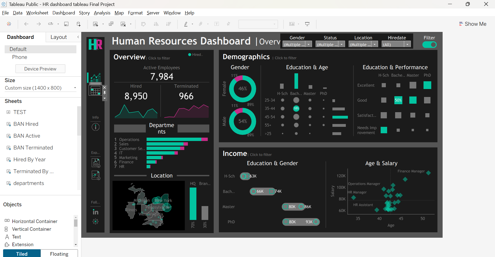
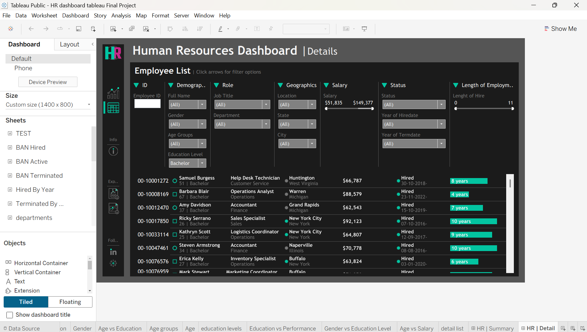
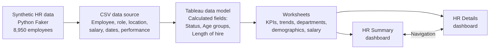

# HR Analytics Dashboard with Tableau

**Interactive two-page Human Resources dashboard in Tableau: workforce KPIs, hiring and termination trends, demographics, performance and salary analysis on 8,950 employees, plus a fully filterable employee list for HR teams.**


---

## At a Glance

| Metric | Result |
|---|---|
| Employees hired | **8,950** |
| Active employees | **7,984** |
| Terminated employees | **966** (about **10.8%** of all hires) |
| Gender split | **54% male (4,801) / 46% female (4,149)** |
| Location split | **70% headquarters (New York) / 30% branches** across 8 states and 24 cities |
| Organisation | **7 departments, 28 job titles**; Operations is the largest (2,718 employees) |
| Salary range | **$51,835 to $149,377** (average **$70,964**) |
| Hiring period | **2015 to 2024** |
| Dashboards | **2 pages** (Summary and Details) with filters, drill-down and page navigation |

---

## Dashboards

### Page 1: HR Summary



**Overview**
- KPI cards for **active, hired and terminated employees**, each with a trend line over the years
- **Departments** ranked by headcount, with active and terminated employees per department
- **Location** map of employees by state, plus the headquarters vs. branch split

**Demographics**
- **Gender** split with the share of terminations per gender
- **Education and age:** a heatmap of education level by age group
- **Education and performance:** how performance ratings relate to education level

**Income**
- **Education and gender:** average salary per education level, compared by gender
- **Age and salary:** scatter plot of salary by age, labelled by job title

Global filters for **gender, status, location and hire date**, and every chart works as a filter for the rest of the page.

### Page 2: HR Details



A **filterable employee list** for HR teams, grouped into ID, demographics, role, geography, salary, status and length of employment. Filters include gender, age group, education, job title, department, state, city, a salary range slider, hire and termination year, and a length-of-hire slider (0 to 11 years).

---

## Business Questions

The dashboard was built from a set of HR business requirements:

1. **How is the workforce developing?** Hires, active employees and terminations over time.
2. **Who works here?** Gender, age, education and location of employees.
3. **How do education and performance relate?**
4. **Is pay fair and consistent?** Salary by education, gender, age and job title.
5. **Can HR find any employee quickly?** A detailed, filterable employee list.

---

## Key Insights

1. **Turnover is about 10.8%, and terminations are rising.** 966 of 8,950 hired employees have left. Terminations grew from about 120 per year in 2018 and 2019 to **174 in 2023**, the highest year.
2. **Finance has the highest turnover.** **13.9%** of Finance employees have left, compared to about 10% to 11% in most other departments.
3. **Hiring comes in waves.** Hiring peaked in **2017 (1,560 hires)**, dropped in **2021 (422)** and recovered strongly in **2022 and 2023 (1,042 and 1,201)**.
4. **Most employees work at headquarters.** 70% are based at the New York HQ, followed by Michigan (976) and Pennsylvania (435).
5. **The gender pay gap depends on education level.** Overall, men earn about **$3.4K more** on average ($72.5K vs. $69.2K). At **bachelor level** men earn more ($73.6K vs. $65.7K), but at **master and PhD level women earn more** (PhD: $92.7K vs. $79.7K).
6. **Management roles lead salaries.** **Finance Manager** has the highest average salary (**$125K**), followed by IT Manager ($114K) and Sales Manager ($104K).
7. **Most employees perform well.** 42% are rated **Good** and 17% **Excellent**, while 13% **Need Improvement**.

### Recommendations for HR

- **Review pay equity at bachelor level**, where the gap between men and women is largest ($7.9K).
- **Investigate turnover in Finance** (13.9%), the department with the highest termination rate.
- **Track the rising termination trend** since 2021 with exit interviews and retention measures.
- **Use the details page for daily HR work**, such as finding employees by role, location or length of employment.

---

## How It Was Built



1. **Data generation:** a realistic, privacy-safe HR dataset generated with **Python Faker** and ChatGPT prompts: employee ID, name, gender, age, education, job title, department, location, salary, hire and termination dates, and performance rating.
2. **Data preparation in Tableau:** calculated fields for **employee status** (`IF ISNULL([Termdate]) THEN 'Hired' ELSE 'Terminated'`), **age** and **age groups**, **length of hire** (years until today or until termination), **headquarters vs. branch**, **full name**, and KPI measures for total hired, active and terminated employees.
3. **Worksheets:** 20 sheets for KPIs (BANs), yearly trends, departments, map, demographics, performance and salary.
4. **Dashboard design:** mockups in draw.io, a consistent dark theme, custom icons, containers for layout, and navigation buttons between the Summary and Details pages.
5. **Interactivity:** dashboard filters, charts as filters, and range sliders on the details page.

---

## Tech Stack

| Area | Tools |
|---|---|
| Visualisation | Tableau (Public Desktop) |
| Data generation | Python, Faker, ChatGPT |
| Design | draw.io (mockups), Procreate, Flaticon icons |
| Tableau features | Calculated fields, BANs, maps, heatmaps, scatter plots, dashboard actions, filters, navigation buttons, containers |

---

## Repository Structure

```
hr-analytics-dashboard-tableau/
├── HR_dashboard_tableau_Final_Project.twbx   # Tableau workbook (open with Tableau Public)
├── hr_data.csv                      # Synthetic HR dataset: 8,950 employees, 14 columns
├── hr_dashboard_overview.png        # Page 1: HR Summary
├── hr_dashboard_details.png         # Page 2: HR Details
├── architecture_hr_dashboard.png    # Build process diagram
└── README.md
```

### Dataset

`hr_data.csv` contains **8,950 synthetic employees** with 14 columns: `Employee_ID`, `First Name`, `Last Name`, `Gender`, `State`, `City`, `Education Level`, `Birthdate`, `Hiredate`, `Termdate` (empty for active employees), `Department`, `Job Title`, `Salary` and `Performance Rating`. All names and records are generated, so no real personal data is used.

---

## Next Steps

- Add **attrition prediction** (which employees are likely to leave) with Python and show the risk in Tableau
- Add **termination rate per department and year** as a dedicated view
- Build a **pay equity analysis** that compares salaries for the same role and education level
- Connect to a **live HR system** instead of a static dataset

---

## Author

**Mayuresh Parche**
M.Sc. Software Engineering, Hochschule Heilbronn | SAP Certified Data Analyst (SAP Analytics Cloud)

[LinkedIn](https://www.linkedin.com/in/mayureshparche/) | [GitHub](https://github.com/Mayureshp21)
